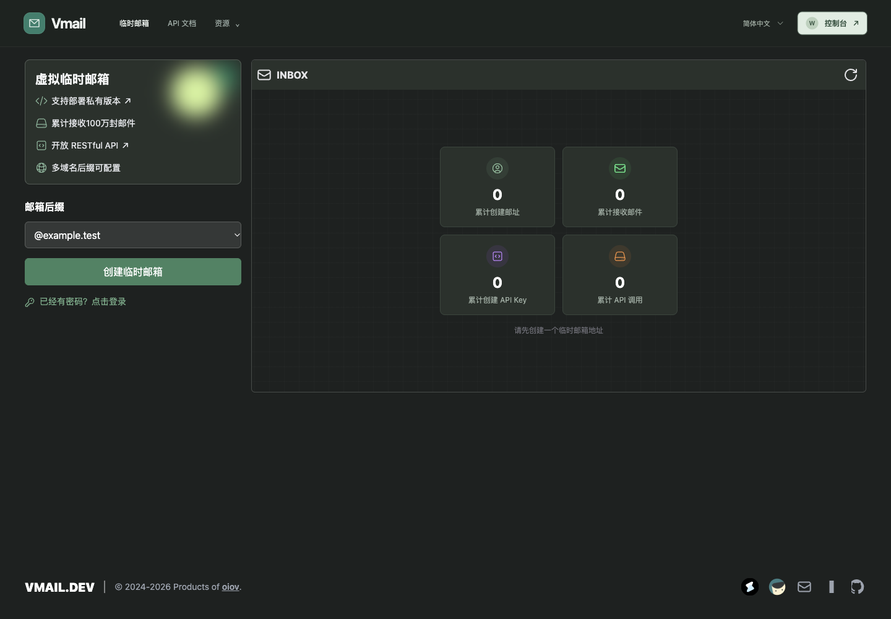
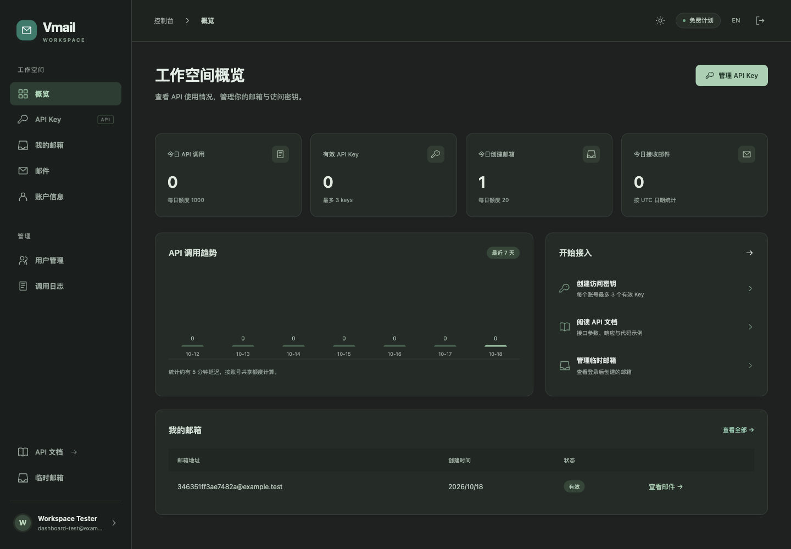
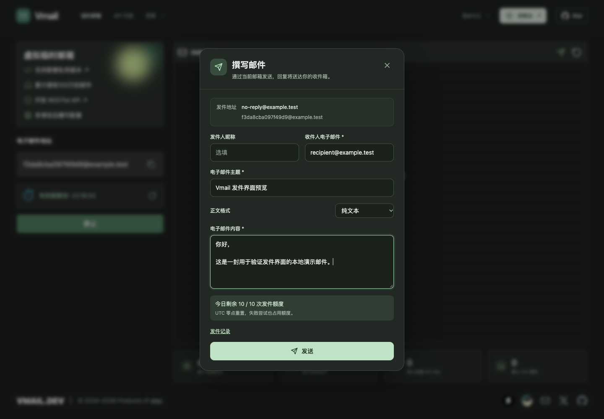
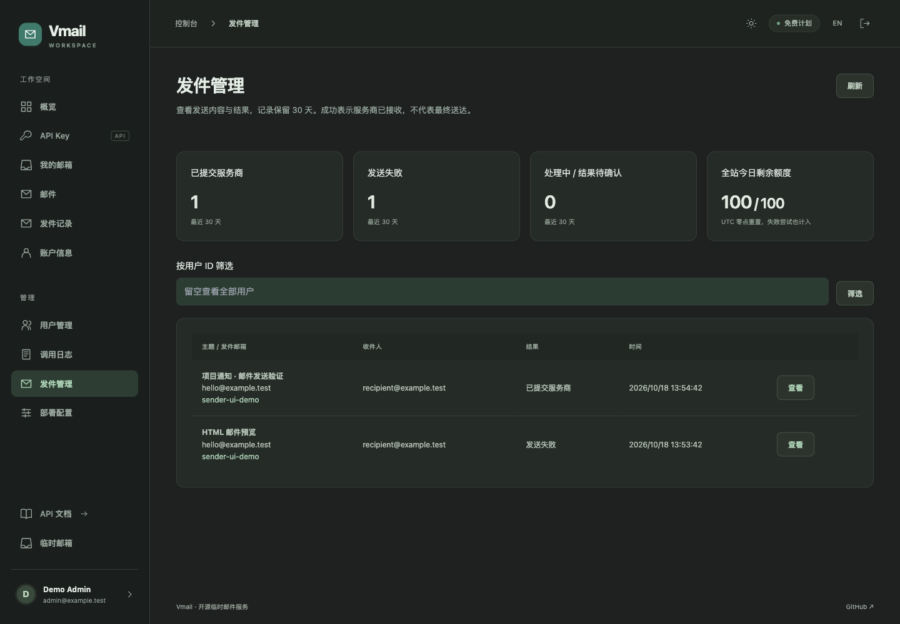
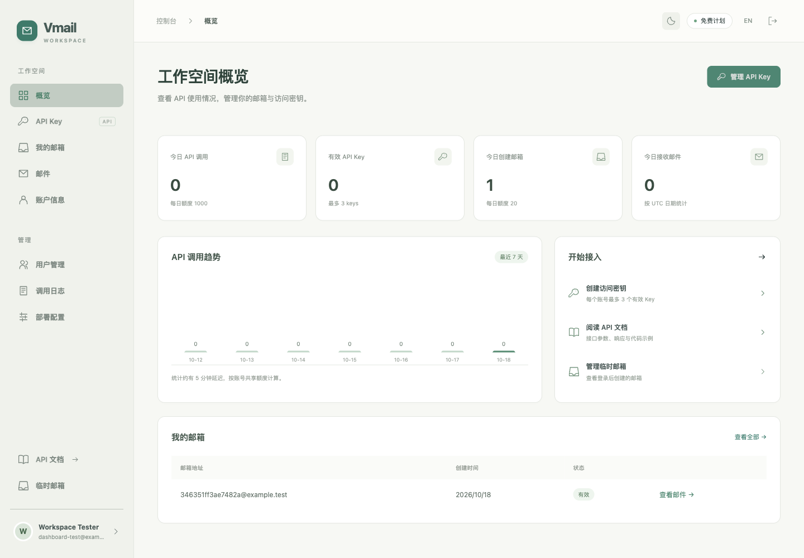
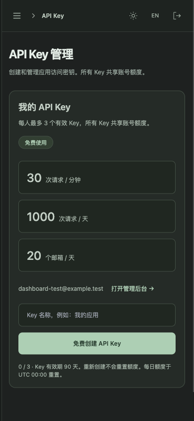
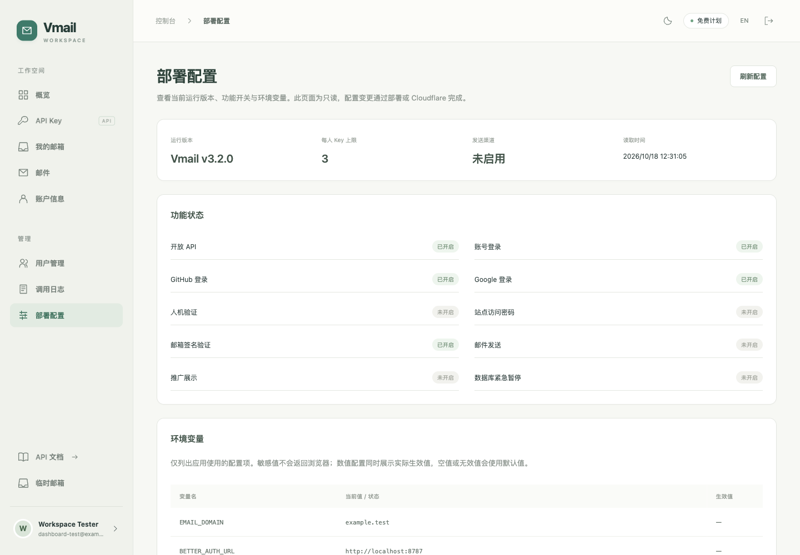

> **Upgrading to v3.2.1? Read the [upgrade guide](docs/UPGRADE.en.md).** Anonymous API keys, old mailbox passwords and pagination changed. Run pnpm setup:check and configure mailbox signing, OAuth and the first administrator before deployment.
See [CHANGELOG](CHANGELOG.md) for release notes.


<div align="center">
  <h1>𝐕𝐌𝐀𝐈𝐋.𝐃𝐄𝐕</h1>
  <p><a href="https://discord.gg/d68kWCBDEs">Discord</a> · English | <a href="/README.md">简体中文</a></p>
  <p>Temporary email service build with email worker.</p>
  </div>

## Dashboard preview

Manage API keys, mailboxes, messages and account information on separate pages. Administrators have dedicated user management and request log pages. The dashboard defaults to dark mode with a persistent light-mode switch. [API documentation](https://vmail.dev/api-docs) is public.

Actual screenshots from a local demo account, with no real user details or access secrets.









<details>
<summary>Light theme and mobile view</summary>







</details>

## Features

- 🎯 Anonymous mailbox creation and receiving; sign-in required for sending and API keys
- ✈️ Support email sending and receiving
- ✨ Save server-issued credentials to restore unexpired mailboxes
- 😄 Support multiple domain name suffixes
- 🔌 **Open RESTful API**, support programmatic access
- 🚀 100% open source, quick deployment, pure Cloudflare solution, no server required

Principles：

- Receiving emails (Cloudflare Email Worker)
- Display email (Vite + React, assets served by the Worker)
- Mail Storage (Cloudflare D1)
- Send email using Resend, MailChannels, or Cloudflare native email

## 📖 API Documentation

Vmail provides a complete RESTful API for programmatic access to create temporary mailboxes and query inboxes.

### Get API Key

Sign in to the [API key dashboard](https://vmail.dev/dashboard/keys) to create a free API key. The [API documentation](https://vmail.dev/api-docs) remains public.

### API Endpoints

| Method | Endpoint | Description |
|--------|----------|-------------|
| `POST` | `/api/v1/mailboxes` | Create temporary mailbox |
| `GET` | `/api/v1/mailboxes/:id` | Get mailbox information |
| `GET` | `/api/v1/mailboxes/:id/messages` | Get inbox (with pagination) |
| `GET` | `/api/v1/mailboxes/:id/messages/:messageId` | Get message details |
| `DELETE` | `/api/v1/mailboxes/:id/messages/:messageId` | Delete message |

### Quick Start

```bash
# 1. Create temporary mailbox
curl -X POST https://vmail.dev/api/v1/mailboxes \
  -H "X-API-Key: your-api-key" \
  -H "Content-Type: application/json"

# Response: { "data": { "id": "abc123", "address": "random@domain.com", ... } }

# 2. Query inbox
curl https://vmail.dev/api/v1/mailboxes/abc123/messages \
  -H "X-API-Key: your-api-key"

# 3. Get message details
curl https://vmail.dev/api/v1/mailboxes/abc123/messages/msg_001 \
  -H "X-API-Key: your-api-key"
```

Full documentation: [https://vmail.dev/api-docs](https://vmail.dev/api-docs)

## Self-hosted Tutorial

This project is based on Cloudflare Workers and Cloudflare D1. All you need is a domain name hosted on Cloudflare.

### Requirements

- [Cloudflare](https://dash.cloudflare.com/) account and a domain name hosted on Cloudflare
- Local installation of [Node.js](https://nodejs.org) (version >= 22.x) and [pnpm](https://pnpm.io/installation)

### Automatic Deployment (Recommended)

This project includes a pre-configured GitHub Action workflow to help you automatically deploy the Vmail application to Cloudflare.

For detailed steps, please refer to the [GitHub Action Auto-Deployment Tutorial](/docs/github-action-tutorial.md).

### Manual deployment

1. Clone and install:

   ```bash
   git clone https://github.com/oiov/vmail
   cd vmail
   pnpm install --frozen-lockfile
   cp .env.example .env
   ```

2. Create a Cloudflare D1 database and fill `.env` with its name/ID, mailbox domains and secrets. Use `CLOUDFLARE_API_TOKEN` / `CLOUDFLARE_ACCOUNT_ID` (or `CF_API_TOKEN` / `CF_ACCOUNT_ID`), or authenticate with `pnpm exec wrangler login`. The token needs Worker deployment and D1 migration permissions.
3. Configure OAuth callbacks, bootstrap admins and optional features, then run:

   ```bash
   pnpm setup:check
   pnpm deploy
   ```

   The script validates, tests, typechecks, builds, applies D1 migrations and deploys Worker assets and Durable Objects. Keep the source `wrangler.toml` placeholders; the script generates the ignored, secret-free `wrangler.deploy.toml` and uploads secrets separately. Cloudflare Pages variables do not configure this Workers project.
4. Match the site custom domain to `BETTER_AUTH_URL`. Enable Email Routing on mailbox domains and set Catch-all → Send to a Worker to this Worker; complete DNS setup.

### Environment variables

Configuration comes from [.env.example](.env.example) and [scripts/configure.mjs](scripts/configure.mjs). Manual deployments use an untracked `.env`; Actions uses repository Secrets/Variables. See the [deployment guide](docs/github-action-tutorial.md) for exact mappings. Dashboard edits may be overwritten by the next deployment.

#### Core configuration

| Variable | Description |
| --- | --- |
| `D1_DATABASE_NAME`/`D1_DATABASE_ID` | Required D1 name and ID; preserve on upgrade |
| `EMAIL_DOMAIN` | Required allowed mailbox domains, comma-separated |
| `MAILBOX_TOKEN_SECRET` | Required for every deployment; independent random secret of at least 32 characters; preserve to keep mailbox tokens valid |
| `TURNSTILE_KEY`/`TURNSTILE_SECRET` | Optional; configure both or leave both empty |
| `PASSWORD` | Optional site password; does not replace OAuth or mailbox tokens |
| `SHOW_AFF` | Default false; true enables promotional UI |
| `ENABLE_OPENAPI` | Default false; true enables /api/v1/* and API key creation; does not hide public docs or control web sending |
| `SUSPEND_DATABASE_ACCESS` | Default false; true pauses HTTP database paths, inbound mail and cleanup; queued statistics may still write |

#### OAuth and administrators

| Variable | Description |
| --- | --- |
| `BETTER_AUTH_URL` | HTTPS site origin, e.g. https://mail.example.com, without a path; local .dev.vars may use http://localhost:8787 |
| `BETTER_AUTH_SECRET` | Independent random session signing secret, at least 32 characters |
| `API_KEY_SECRET` | Independent random API key signing secret, at least 32 characters; rotation invalidates existing keys |
| `GITHUB_CLIENT_ID`/`GITHUB_CLIENT_SECRET` | GitHub OAuth App credentials; use GH_OAUTH_CLIENT_ID / GH_OAUTH_CLIENT_SECRET in Actions |
| `GOOGLE_CLIENT_ID`/`GOOGLE_CLIENT_SECRET` | Google OAuth Web application credentials |
| `ADMIN_EMAILS` | Optional comma-separated verified OAuth emails for bootstrap admins; other new users have role user |

Sign-in, API keys and web sending require complete OAuth configuration for both providers, even when public API access stays disabled. Deployment validation requires it when `ENABLE_OPENAPI=true`. Anonymous mailbox creation and receiving do not require OAuth.

| Provider | Callback URL |
| --- | --- |
| GitHub | `https://mail.example.com/api/auth/callback/github` |
| Google | `https://mail.example.com/api/auth/callback/google` |

Replace the example origin with `BETTER_AUTH_URL`. Set Google Authorized JavaScript origins to the site origin and add test users while in Testing mode. Set your verified email in `ADMIN_EMAILS` before signing in to `/dashboard/admin/users`; the first registered user is not automatically an admin.

#### Quotas and cost controls

| Variable | Default | Scope |
| --- | --- | --- |
| `API_RATE_LIMIT_PER_MINUTE` | 30 | API requests per user per minute, shared across keys |
| `API_DAILY_LIMIT` | 1000 | API requests per user per day |
| `MAILBOX_DAILY_LIMIT` | 20 | API mailbox creations per user per day |
| `MAX_ACTIVE_MAILBOXES` | 20 | Active mailboxes per user |
| `GLOBAL_API_DAILY_LIMIT` | 100000 | Daily HTTP database-path budget, including web and auth; 16 fixed shards |
| `GLOBAL_INBOUND_DAILY_LIMIT` | 100000 | Daily inbound email budget across 16 fixed shards |
| `MAILBOX_INBOUND_DAILY_LIMIT` | 100 | Inbound messages per mailbox per day |
| `MAX_EMAIL_BYTES` | 262144 | Maximum inbound message size in bytes (256 KiB) |
| `SEND_USER_DAILY_LIMIT` | 10 | Daily sending attempts per user, shared across mailboxes |
| `SEND_GLOBAL_DAILY_LIMIT` | 100 | Daily sending attempts across the site, separate from inbound budget |
| `SEND_RATE_LIMIT_PER_MINUTE` | 3 | Sending attempts per user and per mailbox per minute (runtime cap 1,000) |
| `SEND_IP_RATE_LIMIT_PER_MINUTE` | 10 | Sending attempts per IP per minute (runtime cap 1,000) |

Numeric settings must be positive integers. Daily quotas reset at 00:00 UTC. Each user can hold **3 active API keys**, valid for 90 days; the key count is not an environment variable. Anonymous web use also has 20 creations and 3,000 requests per IP daily, plus 30 requests/minute and 3,000/day per mailbox. Busy global shards may exhaust early. These limits are not a hard cap on the Cloudflare bill.

#### Sending configuration

| Variable | Description |
| --- | --- |
| `SEND_CHANNEL` | Empty disables sending; resend / mailchannels / cloudflare; send_email is a legacy alias |
| `SENDER_EMAIL` | Required for sending; fixed provider-approved sender; temporary mailbox is Reply-To |
| `RESEND_API_KEY` | Required only for resend |
| `MAILCHANNELS_API_KEY` | Required only for mailchannels |

Sending requires a signed-in, non-banned user and a valid mailbox token. Provider failures consume quota; Durable Objects enforce limits before D1 send-log writes. Users view `/dashboard/outbound`; admins review the site at `/dashboard/admin/outbound`. Native Cloudflare sending uses `SEND_EMAIL` and requires Email Routing and Cloudflare recipient/sender permissions; arbitrary recipients are not guaranteed.

`COOKIES_SECRET` belongs to the legacy frontend mailbox-password scheme and is unused by the deployment script; new deployments do not need it. The three signing secrets serve different purposes.

## Local development

Use independent test secrets. Wrangler reads local bindings from `.dev.vars`; the deployment script reads `.env`. Keep these separate.

```bash
cp .dev.vars.example .dev.vars
# Fill local signing secrets before starting.
pnpm exec wrangler d1 migrations apply DB --local
pnpm dev
```

Open `http://localhost:8787`. `pnpm dev` builds and serves the frontend through Wrangler; it does not start Vite HMR. Run `pnpm frontend:dev` separately for HMR. Use the same-origin 8787 entry and matching callbacks for OAuth/sending. Local D1/DO are simulated; a remote database is not required. `pnpm setup:check` validates deployment `.env`; use `pnpm test` and `pnpm typecheck` for code checks.

## Community Group

- Discord: https://discord.gg/d68kWCBDEs

## License

GNU General Public License v3.0

## Star History

[](https://star-history.com/#oiov/vmail&Date)


## Sending authorization, quotas and audit

After upgrading, /api/send requires a signed-in session, valid mailbox token and same-site Origin. Anonymous mailbox holders must sign in first. Banned accounts and mailboxes owned by another account are rejected.

New settings: SEND_USER_DAILY_LIMIT=10 and SEND_GLOBAL_DAILY_LIMIT=100. Attempts, including provider failures, consume quota. User quotas span mailboxes and reset at 00:00 UTC. Existing mailbox/IP minute limits remain; the mailbox minute limit also applies per user. Durable Objects atomically reserve quota before provider dispatch.

Apply 0006_outbound_logs.sql before deployment (the deployment script does this). Users view their own mail at /dashboard/outbound; admins review all content and filter by user at /dashboard/admin/outbound. Subject, body, addresses and result are retained for 30 days, with hourly cleanup. HTML is sandboxed and remote resources are blocked. Success means provider acceptance, not delivery; pending may mean an unconfirmed result, so do not automatically retry.
